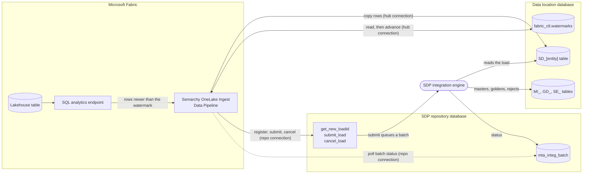

# Semarchy OneLake Ingest

**Incremental loading from Microsoft Fabric OneLake into Semarchy Data Platform.**

Semarchy OneLake Ingest turns a table in a Microsoft Fabric Lakehouse into a governed source for
Semarchy Data Platform (SDP). On every run it picks up the records that changed, loads them into an
SDP data location, and hands them to SDP's own certification: matching, merging, validation and
survivorship produce the golden records, exactly as for any other source system.

It is delivered as a Fabric Data Pipeline that you deploy into your own workspace, with the
database setup and deployment tooling to run it securely.

> **Status: Preview.** Validated end to end on SDP 2025.1 with Azure Database for PostgreSQL 16.
> See [Compatibility](#compatibility) for what is not yet validated.

## Key capabilities

- **Incremental by design.** Each run reads only the rows changed since the last successful run,
  using a watermark kept next to your SDP data. Runs with nothing new finish in about two minutes
  and leave nothing behind.
- **Native SDP certification.** Records enter through SDP's standard load API and integration job,
  so your data product's match rules, validations, enrichers and survivorship apply unchanged.
  Records from Fabric merge with the matching records your other sources already provide.
- **Safe failure handling.** A failed step cancels its load, and the watermark only moves after SDP
  has certified the batch, so a failed run is simply retried on the next schedule.
- **Least-privilege access.** The pipeline connects with a dedicated login that can write source
  records and call the load API, and nothing else.
- **Private networking.** All database traffic goes through your Fabric VNet data gateway; the
  Postgres servers need no public access.
- **Repeatable deployment.** One environment file per deployment drives the database setup, the
  Fabric connections and the pipeline. Promoting to another environment, or upgrading to a new
  version, is a redeploy.

## How it works



1. **Read the watermark** for the entity: the latest source timestamp already certified.
2. **Register a load** with SDP and **copy the changed rows** from the Lakehouse SQL analytics
   endpoint into the entity's source-data table.
3. **Submit the load** to the data location's integration job, or cancel it if nothing changed.
4. **Wait for certification**, then **advance the watermark** to what was loaded.

Both connections go through the Fabric VNet data gateway, and the two databases can be on
different servers. The full sequence, including the failure paths and the watermark rules, is in
[Architecture and design](docs/how-it-works.md).

## Requirements

| Component | Requirement |
|---|---|
| Semarchy Data Platform | 2025.1, with its repository and data location on Azure Database for PostgreSQL |
| PostgreSQL | 16 (validated). The pipeline uses ordinary database connections, not Fabric mirroring, so mirroring's server type and tier requirements do not apply. |
| Microsoft Fabric | A workspace on a capacity; the source Lakehouse with its SQL analytics endpoint |
| Networking | A Fabric VNet data gateway that reaches the Postgres servers on port 5432 |
| Source data | A publisher code, a source record ID, the attributes, and a UTC "last updated" timestamp per row |
| Deployment machine | Python 3.9 or later; Azure CLI or the `azure-identity` package; `psql` (or `kubectl` for servers reachable only from AKS) |

## Getting started

1. **Collect** the data location, repository and integration job details from your SDP instance.
2. **Describe your deployment** in an environment file, starting from
   [`environments/example.json`](environments/example.json): workspace, gateway, Lakehouse, the
   two databases, and the column mapping for each entity.
3. **Prepare the databases** with the provided SQL scripts: a dedicated `fabric_loader` login and
   a watermark table. A rolled-back dry run lets you test them first.
4. **Create the connections and deploy the pipeline**:
   ```bash
   python scripts/create_connections.py -e environments/<name>.json
   python scripts/deploy_pipeline.py -e environments/<name>.json
   ```
5. **Run it once**, check the result, then set a schedule in Fabric:
   ```bash
   python scripts/run_pipeline.py -e environments/<name>.json
   ```

The [Setup guide](docs/setup-guide.md) covers each step in detail, including which account runs
each script.

## Documentation

| Guide | Contents |
|---|---|
| [Setup guide](docs/setup-guide.md) | Installation step by step, operations, upgrades, private database servers |
| [Architecture and design](docs/how-it-works.md) | The run sequence, watermark rules, failure handling, and how to change the pipeline |
| [Troubleshooting](docs/troubleshooting.md) | Symptoms and fixes |
| [Release notes](https://github.com/semarchy/onelake-ingest/releases) | What changed in each version, and how to upgrade |

## Compatibility

| | Status |
|---|---|
| Full and incremental loads, cross-system matching, parent references | Validated |
| Runs with nothing new (load cancelled, watermark unchanged) | Validated |
| Data location database setup for `fabric_loader` | Validated (rolled-back dry run) |
| Repository database setup for `fabric_loader` | Not yet validated |
| Cancel-on-failure paths; batches ending `ERROR` or `SUSPENDED` | Not yet validated |

Validate the items marked "Not yet validated" in a test environment before production use.

## Security

- The `fabric_loader` login has exactly the rights the pipeline uses: insert, select and update on
  the source-data tables it loads and on the watermark table; execute on the three load functions
  and select on the batch status table in the repository.
- No password, key or other secret is stored in the package, in environment files or in the
  deployed pipeline. Passwords are read from environment variables at setup time and stored by
  Fabric in its connections.
- Connections are created private to the person who creates them; share them deliberately.

## Support

Contact your Semarchy representative for help with installation, or to report an issue.

## License

© 2026 Semarchy. Released under the [MIT License](LICENSE).
