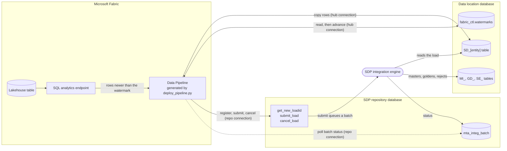

# OneLake to Semarchy

Load tables from a Microsoft Fabric Lakehouse into a Semarchy Data Platform (SDP) data location,
incrementally, with a Fabric Data Pipeline. Each run picks up the rows changed since the last
successful run, writes them to the data location's source-data table, submits them for
certification, and waits for the result.



Both connections go through the Fabric VNet data gateway; the two databases can be on different
servers. The order of a run, including the empty-run and failure branches, is in
[docs/how-it-works.md](docs/how-it-works.md#the-run-step-by-step).

The pipeline is a Fabric pipeline definition kept in this repository as a template,
[pipeline/pipeline-content.template.json](pipeline/pipeline-content.template.json). One environment
file fills in its connections, tables and column mapping, and the result is published through the
Fabric REST API. The database setup scripts take their values from the same file.

How the pipeline works, and why it is built this way: [docs/how-it-works.md](docs/how-it-works.md).

## What you need

- **SDP on Azure Database for PostgreSQL – Flexible Server.** Tested with SDP 2025.1 on PostgreSQL 16.
- **Network access from Fabric to the Postgres servers**: a Fabric VNet data gateway whose subnet
  can reach the servers (private endpoint or VNet integration, port 5432).
- **A Fabric workspace on a capacity** for the pipeline, and the source Lakehouse (same or another
  workspace) with its SQL analytics endpoint.
- **A source table shaped for Semarchy**: a publisher code column (e.g. `PublisherID`), a source
  record ID column (e.g. `SourceID`), the attribute columns, and a timestamp column that increases
  whenever a row changes (e.g. `LastUpdated`), in UTC.
- **Tools on the machine you deploy from**: Python 3.9+, and either the Azure CLI (`az login`) or
  `pip install azure-identity`. `psql` for the database setup, or `kubectl` if the Postgres servers
  are only reachable from an AKS cluster (see [Private servers](#private-servers)).

## Layout

```
pipeline/pipeline-content.template.json   the pipeline: Fabric definition with {{TOKENS}}
environments/example.json      template for an environment file (copy it; real ones are gitignored)
sql/01_create_loader_role.sql  create the fabric_loader login           (both servers, as admin)
sql/02_hub_watermarks.sql      create the watermark table               (data location database)
sql/03_hub_grants.sql          let fabric_loader write the SD tables    (data location database)
sql/04_repo_grants.sql         let fabric_loader call the load API      (repository database)
sql/05_hub_seed_watermark.sql  optional: skip history already loaded    (data location database)
sql/check/                     dry runs, post-setup checks, post-run verification
scripts/create_connections.py  create the two Fabric connections on the gateway
scripts/deploy_pipeline.py     fill in the template from the environment file and publish it
scripts/run_pipeline.py        run it now and print every step's result
scripts/psql_in_cluster.sh     run the SQL scripts from inside AKS when the servers are private
```

## Setup

### 1. Collect the values

The pipeline touches **two databases, which can be on different servers**: the data location's
database (where the SD tables are) and the SDP repository database (where the load functions are).

| Value | Where to find it |
|---|---|
| Data location name | SDP → Data Locations. The **name**, not the label. |
| Data location database + server | `sem dm data-locations` → its `dataSource`; then `sem dm admin datasources get <dataSource>` → JDBC `url` |
| Repository database + server | `sem dm admin repository` → `name`; the host is in the SDP namespace's `dm-postgres` secret (`database-host`) |
| Repository schema | The schema holding `get_new_loadid`: the repository login role, `dm-postgres` secret key `semarchy-repository-role`. Often contains hyphens. |
| Integration job | Query below, on the repository database. Use the job that integrates every entity (often `INGEST_ALL`), not a `DAJ_`/`DDJ_`/`DUJ_` job. |
| SD table and columns | `sd_<entity>` in the data location database. Column names are lowercase. |

```sql
select jd.name
  from mta_data_loc_job dlj
  join mta_job_def jd on jd.uuid = dlj.r_jobdef
  join mta_data_location dl on dl.uuid = dlj.o_datalocation
 where dl.name = '<DataLocation>' and dlj.jobtype = 'INTEGRATION_JOB' and dlj.r_deployhist is null;
```

### 2. Write the environment file

```bash
cp environments/example.json environments/<name>.json
```

Fill it in. Column mapping rules (one `pipelines` entry per entity):

- `publisherIdColumn` → `b_pubid` and `sourceIdColumn` → `b_sourceid` are mapped for you.
- `columns`: each Lakehouse column → its lowercase SD column. Set `"type": "timestamp"` or
  `"number"` on non-text columns; text columns get the blank-to-null cleanup.
- A reference to a parent record goes in as the parent's source key:
  `PublisherID_<Role>` → `fp_<role>` and `SourceID_<Role>` → `fs_<role>`.
- Leave out attributes the platform computes (enrichers): they are filled during certification.
- `watermarkColumn` must be one of the mapped columns.

`environments/*` is gitignored except the template, so real hostnames and user names never reach
the repository. Passwords are never in the file: `passwordEnv` names the environment variable to
read them from.

### 3. Set up the databases

Run in this order. Each script says at the top who must run it and where.

| # | Script | Database | Run as |
|---|---|---|---|
| 1 | `sql/01_create_loader_role.sql` | data location DB | server admin |
| 2 | `sql/01_create_loader_role.sql` with `-v repo_schema=<schema>` | repository DB | **repository server's** admin |
| 3 | `sql/02_hub_watermarks.sql` | data location DB | data location owner or admin |
| 4 | `sql/03_hub_grants.sql` with `-v sd_tables=public.sd_<entity>,...` | data location DB | owner of the SD tables |
| 5 | `sql/04_repo_grants.sql` with `-v repo_schema=<schema>` | repository DB | repository owner role |
| 6 | `sql/05_hub_seed_watermark.sql` (optional) | data location DB | owner |

Use the same `fabric_loader` password on both servers or different ones; `01` takes it as
`-v loader_password=...`. Example:

```bash
psql "host=<hub server> dbname=<data location db> user=<admin> sslmode=require" \
     -v loader_password="$LOADER_PASSWORD" -f sql/01_create_loader_role.sql
```

**Try it first without changing anything.** `sql/check/hub_dry_run.sql` runs steps 1, 3 and 4 in
one transaction, performs every pipeline operation as `fabric_loader`, and rolls it all back.
`sql/check/repo_dry_run.sql` does the same for the repository, but needs one account that can both
create roles and grant on the repository objects (see its header). After the real setup,
`sql/check/hub_check.sql` and `sql/check/repo_check.sql`, run **as fabric_loader**, confirm the
grants; they roll back their own test writes.

### 4. Create the Fabric connections

```bash
export HUB_DB_PASSWORD=...  REPO_DB_PASSWORD=...     # fabric_loader's passwords
python scripts/create_connections.py -e environments/<name>.json --check   # what would happen
python scripts/create_connections.py -e environments/<name>.json
```

Fabric logs in through the gateway before saving a connection, so success proves both the network
path and the credentials. A new connection is visible only to you until shared (Manage
connections and gateways → the connection → Manage users).

### 5. Deploy the pipeline

```bash
python scripts/deploy_pipeline.py -e environments/<name>.json --dry-run   # build into build/ only
python scripts/deploy_pipeline.py -e environments/<name>.json
```

Creates the pipeline, or replaces its definition if it exists. Redeploy after any change to the
environment file or the template. Changes made only in the Fabric UI are overwritten by the next
deploy: to change what the pipeline does, edit the template (see
[Changing the pipeline](docs/how-it-works.md#changing-the-pipeline)).

### 6. Run and verify

```bash
python scripts/run_pipeline.py -e environments/<name>.json
```

Prints each step: the watermark used, the load ID, rows copied, the batch ID and status, and the
new watermark. Then check what certification made of it with `sql/check/verify_run.sql`.

### 7. Schedule

In Fabric, open the pipeline → **Schedule**. A run with nothing new costs one cancelled load and
about two minutes, so hourly is fine.

## Operating it

- **Reset or move the watermark**: update or delete the entity's row in `fabric_ctl.watermarks`.
  Deleting it reloads the whole table on the next run (records are updated, not duplicated).
- **Add an entity**: add a `pipelines` entry, grant its SD table (`sql/03_hub_grants.sql`), deploy.
- **Rotate the loader password**: re-run `sql/01_create_loader_role.sql`, then
  `create_connections.py --update-credentials`.
- **A failed run** cancels its load, so nothing is left `RUNNING`, and does not move the watermark,
  so the next run retries the same rows.

## Troubleshooting

| Symptom | Cause |
|---|---|
| Creating a connection: "The credentials provided for the AzurePostgreSQL source are invalid" | Usually the **server**, not the password: a login that does not exist on that server fails the same way. Check you have the data location's server for `hub` and the repository's for `repo`. |
| `relation "mta_data_location" does not exist` in GetLoadId | `fabric_loader`'s search_path lacks the repository schema. Re-run `01` on the repository DB with `-v repo_schema`. |
| `permission denied to create role` | `01` was run by a role without CREATEROLE. Run it as the server admin. |
| `No Integration Job named ...` in SubmitLoad | Wrong `integrationJob`; see step 1. |
| Batch ends `WARNING` | Normal: warning-level validations fired on some records. The run succeeds and the watermark advances. |
| Batch ends `SUSPENDED` | Needs a person: the data location's integration queue is stopped until the batch is resolved in SDP. |
| A deploy of the data location fails with HTTP 500 | Look for a `RUNNING` load. The pipeline cancels its own on failure; a load from an interrupted run may need cancelling in SDP. |

## Private servers

If the Postgres servers have public access disabled and are reachable only from an AKS cluster
(typical for self-hosted SDP), `scripts/psql_in_cluster.sh` runs any script in `sql/` from a
short-lived pod in that cluster and deletes it afterwards. Passwords are piped in on stdin, never
placed on a command line or in a pod spec. `--rollback` wraps a setup script in a transaction that
is rolled back. Run `scripts/psql_in_cluster.sh --help` for the options.

## Security

- `fabric_loader` gets exactly what the pipeline uses: INSERT/SELECT/UPDATE on the SD tables it
  loads and on the watermark table; EXECUTE on three load functions and SELECT on the batch table
  in the repository. Never put the server admin or the repository owner in a Fabric connection:
  everyone the connection is shared with gets those rights.
- No secret is stored in this repository, the environment file or the pipeline definition.
