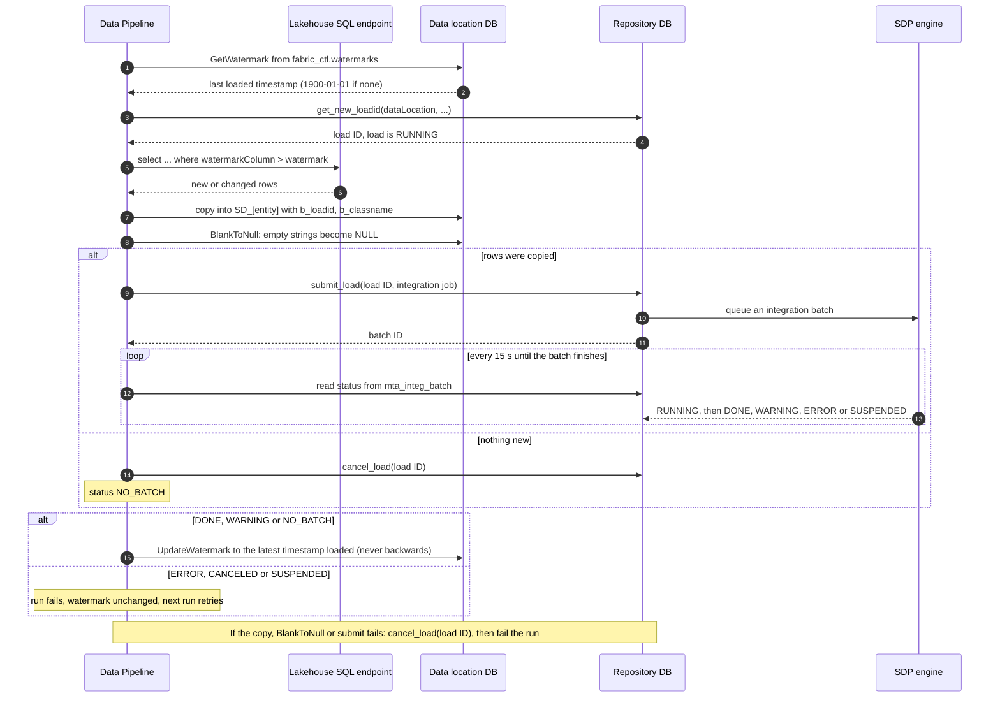

# How it works

## The two databases

SDP keeps its data in two places, and this pipeline needs both:

- **The data location's database** holds the entity tables. A load writes source records into
  `SD_<entity>`; certification turns them into master (`MI_`) and golden (`GD_`) records and puts
  rejected records in `SE_`.
- **The repository database** holds SDP's metadata, including the SQL load API:
  `get_new_loadid`, `submit_load` and `cancel_load`, in a schema named after the repository login
  role. Batch status is in its `mta_integ_batch` table. There is no status function.

They are often on different servers. The pipeline therefore has two Fabric connections, `hub` and
`repo`.

**SD, not SA.** `SA_<entity>` holds records authored by people in the SDP app. It is keyed by the
golden ID and has no publisher or source-ID columns. Records from a source system go to `SD_<entity>`,
keyed by load ID, publisher and source ID.

## The run, step by step

Which component the pipeline talks to at each step (the components themselves are drawn in the
[README](../README.md)):



| Step | Connection | What it does |
|---|---|---|
| GetWatermark | hub | Reads the entity's last loaded timestamp from `fabric_ctl.watermarks` (1900-01-01 if none). |
| GetLoadId | repo | `get_new_loadid(...)`: registers a load, status `RUNNING`. |
| CopyToSD | SQL endpoint → hub | Selects the rows with `watermarkColumn > watermark` from the Lakehouse's SQL analytics endpoint and bulk-copies them into `SD_<entity>`, stamped with the load ID and class name. |
| BlankToNull | hub | Turns empty strings in the load's text columns into NULL. |
| HasNewRows | | Nothing copied: cancel the empty load and stop. Otherwise: `submit_load(...)` with the integration job, which creates an integration batch. |
| WaitForBatch | repo | Polls `mta_integ_batch` every 15 s until the batch is `DONE`, `WARNING`, `ERROR`, `CANCELED` or `SUSPENDED` (timeout 1 h). |
| BatchSucceeded | hub | `DONE` or `WARNING`: advance the watermark. Anything else: fail the run and leave the watermark. |

Why some steps are built the way they are:

- **The source is the SQL analytics endpoint, not the Lakehouse table.** A Lakehouse table source
  copies whole tables; it cannot filter rows. The endpoint takes a query, so the watermark filter
  runs at the source. The load ID and class name are added as query columns.
- **Blank to null.** Lakehouse tables often hold `''` where a source had no value. SDP reads an empty
  `fs_<role>` as a reference to a parent whose source ID is blank, not as "no parent", and an empty
  attribute is not the same as a missing one for validations and survivorship.
- **Empty runs cancel their load** instead of submitting it, so quiet runs leave no empty batches
  behind.
- **WaitForBatch sits after HasNewRows, not inside it,** because pipeline nesting rules restrict an
  Until inside an If. On an empty run it makes one quick pass and exits.
- **Every step that can fail after the load exists cancels the load.** A `RUNNING` load that is
  never submitted or cancelled blocks the next deployment of the data location.
- **All SQL calls are Lookup activities.** Each returns one row that the next step reads.

## The watermark

- **Where**: `fabric_ctl.watermarks` in the data location database, one row per entity (keyed by
  class name): `last_value`, `last_load_id`, `updated_at`.
- **Advances only after a successful batch**, to the latest timestamp that actually landed in
  `SD_<entity>` for that load, read back from Postgres. It cannot skip rows that were not loaded,
  and `greatest()` keeps it from moving backwards.
- **Strictly greater than.** A row whose timestamp equals the watermark is not reloaded, so a row
  that arrives late carrying the same timestamp as the last loaded one would be missed. With
  per-second "last updated" timestamps this is rare. If the source cannot rule it out, change `>`
  to `>=` in the CopyToSD query of `pipeline/pipeline-content.template.json`: boundary rows are then
  reloaded every run, which is harmless because the same source IDs update the same records.
- **UTC throughout.** Lakehouse timestamps are UTC; the copy stores them in SD without a zone; the
  watermark is a `timestamptz` compared as UTC.
- **Fractional seconds are dropped** when the Lookup returns the watermark. That only moves it
  back, so at worst a few rows from the same second are reloaded.
- **SQL endpoint lag.** The endpoint reflects Lakehouse writes after a short delay. A run that
  starts right after a write can miss the newest rows; the next run picks them up, because the
  watermark only advances to what was loaded.

## Changing the pipeline

The pipeline is `pipeline/pipeline-content.template.json`: the complete Fabric Data Pipeline
definition (the `pipeline-content.json` part of a Fabric item), with tokens where a value depends
on the environment. `scripts/pipeline_builder.py` only fills in the tokens; it contains no pipeline
logic. To change what the pipeline does (a query, a timeout, the polling interval, a new activity),
edit the template, then check and publish:

```bash
python scripts/deploy_pipeline.py -e environments/<name>.json --dry-run   # renders into build/
python scripts/deploy_pipeline.py -e environments/<name>.json
```

The render fails if the template uses a token the renderer does not know, or leaves one unfilled.

Prototyping in the Fabric UI works too: edit a deployed pipeline there, download its definition
(`POST /v1/workspaces/{ws}/items/{id}/getDefinition`, part `pipeline-content.json`), and carry the
change back into the template, putting tokens back where the environment's values appear.

Tokens. `{{NAME}}` sits inside a JSON string and is replaced by the value, escaped; `"{{JSON:NAME}}"`
is replaced, quotes included, by a JSON value.

| Token | Value |
|---|---|
| `HUB_CONNECTION_ID`, `REPO_CONNECTION_ID` | IDs of the connections named in the environment file, looked up in Fabric |
| `LAKEHOUSE_NAME`, `LAKEHOUSE_WORKSPACE_ID`, `SQL_ENDPOINT_ID`, `SQL_ENDPOINT_HOST` | the source Lakehouse and its SQL analytics endpoint, looked up in Fabric |
| `DATA_LOCATION`, `INTEGRATION_JOB`, `SDP_USER` | `semarchy` section (pipeline parameter defaults) |
| `REPO_SCHEMA` | `semarchy.repositorySchema` (the template quotes it) |
| `WATERMARK_SCHEMA`, `WATERMARK_TABLE` | `watermark` section |
| `CLASS_NAME`, `SOURCE_SCHEMA`, `SOURCE_TABLE`, `WATERMARK_COLUMN` | the pipeline entry (parameter defaults) |
| `SD_SCHEMA`, `SD_TABLE` | the pipeline entry's `sdTable`, split |
| `WATERMARK_SD_COLUMN` | the SD column `watermarkColumn` maps to |
| `SOURCE_COLUMNS` | the Lakehouse columns to select, in T-SQL brackets |
| `BLANK_TO_NULL_SET` | the `SET` list that turns empty strings into NULL in the text columns |
| `JSON:COPY_MAPPINGS` | the Copy activity's column mapping |
| `DESCRIPTION` | the pipeline description |

## What has been tested

On SDP 2025.1 with PostgreSQL 16, a VNet data gateway, and a schema-enabled Lakehouse:

- a full first load (19 records; new records created, cross-system duplicates matched into existing
  golden records, parent references resolved, nothing rejected);
- an incremental run that loaded only the rows newer than the watermark and advanced it;
- empty runs that cancelled their load and left the watermark unchanged;
- `sql/check/hub_dry_run.sql` against a real data location database.

Not yet exercised: the cancel-on-failure paths, a batch ending `ERROR` or `SUSPENDED`, and the
repository grants for `fabric_loader` (`sql/04`, `sql/check/repo_dry_run.sql`). Until those are
run, connect `repo` with the repository owner role in a test environment only.
